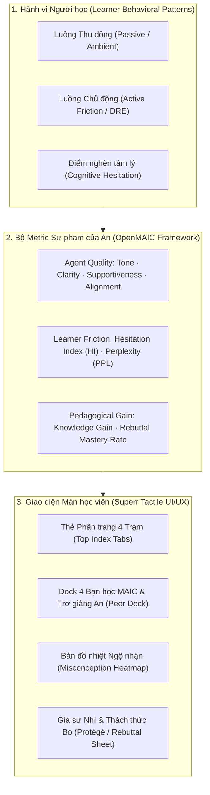

# BÁO CÁO THỐNG NHẤT TÍNH NĂNG & THIẾT KẾ UI/UX DƯỚI MÀN HỌC VIÊN
**Dự án: Nền tảng Học tập Đối chất Đa tác nhân DRE (DRE Learning / OpenMAIC)**  
**Phân vai:** Khuê Minh (Frontend & Product UI/UX Lead)  
**Phối hợp:** An (Nghiên cứu Paper OpenMAIC & Metric Sư phạm), Hiếu (Multi-Agent Pipeline), Blu e's (Điều phối)  
**Mục tiêu:** Thống nhất danh mục tính năng màn hình học viên (Learner POV), phương pháp tiếp cận hành vi, và demo Mockup UI/UX tích hợp trực tiếp bộ Metric của An.

---



---

## PHẦN 1: PHÂN TÍCH HÀNH VI NGƯỜI HỌC (LEARNER BEHAVIORAL ANALYSIS)

Đối tượng người học mục tiêu là **học sinh THCS & THPT (K-12, 12–16 tuổi)** đang ôn luyện môn Toán. Khi học trực tuyến hoặc tự học video, hành vi người học phân hóa thành 3 nhóm tâm lý điển hình:

### 1. Phân loại 2 Luồng Hành vi Cốt lõi
| Đặc tính | Luồng Thụ động (Passive / Ambient Mode) | Luồng Chủ động (Active Interruption Mode) |
| :--- | :--- | :--- |
| **Hành vi thực tế** | Xem video bài giảng, nghe giảng, đọc bình luận trôi nổi, theo dõi bạn bè trao đổi. | Bấm nút *"Khoan đã cô ơi!"*, chọn bước sai trên đề bài, gõ câu phản biện đáp trả Bo. |
| **Trạng thái nhận thức** | Tiêu thụ thông tin liên tục, dễ rơi vào ảo giác *"mình đã hiểu bài"* (Illusion of Competence). | Đối mặt với mâu thuẫn nhận thức (Cognitive Conflict), buộc phải kích hoạt tư duy phản biện. |
| **Điểm rơi Dropout** | Khi gặp công thức trừu tượng hoặc tiết tấu video đơn điệu quá 45 giây. | Khi bị hỏi bất ngờ mà không biết trả lời thế nào, sợ trả lời sai bị bạn bè chê cười. |
| **Giải pháp UX** | Luồng Live Stream Ambient: Bạn Bo ngây ngô và các bạn học AI thảo luận tự nhiên, khơi gợi tò mò. | Giàn giáo sư phạm (Scaffolding): Gợi ý câu mở đầu (*Nudge Starter*), sticker phản biện chọn nhanh. |

### 2. Các Rào cản Tâm lý (Cognitive Friction Points)
1. **Mặc cảm sợ sai (Fear of Failure):** Học sinh ngại phát biểu vì sợ câu trả lời ngớ ngẩn. 
   - *Cách hóa giải:* Đưa nhân vật **Bo Ngây Ngô** làm "vật tế thần sư phạm" (Pedagogical Fall Guy). Bo cãi cùn và sai trước, học viên chỉ đóng vai trò người đi bắt bẻ Bo.
2. **Ảo tưởng trực giác (Intuitive Bias / Shortcut Fallacy):** Thấy $\frac{x+2}{x+4}$ là gạch chéo $x$; thấy $-(x-5)$ là mở ngoặc thành $-x-5$.
   - *Cách hóa giải:* Bo đứng ra bảo vệ đúng trực giác sai này (*"Gạch phăng đi cho nhanh!"*), kích thích học sinh tự phân tích tại sao không được làm tắt.
3. **Mất tập trung sau 40–60 giây:**
   - *Cách hóa giải:* Hệ thống tự động kích hoạt **45s Inactivity Nudge** (Trợ giảng An hoặc Cô Lam gõ nhẹ bàn hỏi thăm).

---

## PHẦN 2: TÍCH HỢP BỘ METRICS SƯ PHẠM CỦA AN (OPENMAIC MAPPING)

Bộ metric của An được xây dựng trên khung nghiên cứu chuẩn của Đại học Thanh Hoa (*"From MOOC to MAIC: Reshaping Online Teaching and Learning through LLM-driven Agents"* - JCST 2024). Để chuyển các metric này thành tính năng hiển thị trực tiếp dưới màn học viên, Khuê đã ánh xạ tương ứng như sau:

```
+---------------------------------------------------------------------------------------------------+
|                           BẢNG ÁNH XẠ METRICS CỦA AN -> TÍNH NĂNG MÀN HỌC VIÊN                   |
+------------------------------+--------------------+-----------------------------------------------+
| METRICS CỦA AN (RESEARCH)    | THANG ĐO / CHỈ SỐ  | TÍNH NĂNG & THÀNH PHẦN HIỂN THỊ UI/UX         |
+------------------------------+--------------------+-----------------------------------------------+
| 1. Clarity (Độ sáng rõ)      | 1 - 5 Likert Scale | • Thẻ Tóm tắt Ghim (Pinned Summary của TA An) |
|                              |                    | • Khung lời giải chuẩn từng bước có gạch chân |
+------------------------------+--------------------+-----------------------------------------------+
| 2. Tone (Tông giọng phù hợp) | 1 - 5 Likert Scale | • Phân vai rõ rệt: Bo (hài hước), Trí (sâu)   |
|                              |                    | • Nhãn [🤖 AI] minh bạch, an toàn K-12       |
+------------------------------+--------------------+-----------------------------------------------+
| 3. Supportiveness (Khích lệ) | 1 - 5 Likert Scale | • Thẻ Cheer Message từ TA An khi bí bài       |
|                              |                    | • Không guilt-trip khi bấm "Tạm dừng"         |
+------------------------------+--------------------+-----------------------------------------------+
| 4. Alignment (Khớp mục tiêu) | 1 - 5 Likert Scale | • 4 Trạm học tập chia thẻ mục kẹp sổ          |
|                              |                    | • Kiểm tra từ khóa toán học (Rule Evaluator) |
+------------------------------+--------------------+-----------------------------------------------+
| 5. Hesitation Index (HI)     | HI = ΔT / ln(chars)| • Thanh đồng hồ đo nhịp suy ngẫm (Nudge Timer)|
|                              |                    | • Nút "Cần gợi ý nhẹ" tự sáng khi HI > 3.5    |
+------------------------------+--------------------+-----------------------------------------------+
| 6. Perplexity / Fallacy Heat | Tỉ lệ % mắc bẫy    | • Bản đồ nhiệt Ngộ nhận (Misconception Heatmap)|
|                              | (500+ học sinh)    | • Thống kê: "74% bạn bè cũng nhầm ở bước 2"   |
+------------------------------+--------------------+-----------------------------------------------+
| 7. Rebuttal Mastery Rate     | Tỉ lệ khuất phục   | • Dấu mộc mực đỏ ĐÃ PHẢN BIỆN THÀNH CÔNG      |
|                              | Bo thành công      | • Bo gãi đầu nhận thua (Bo Concession State)  |
+------------------------------+--------------------+-----------------------------------------------+
```

---

## PHẦN 3: CÁCH TIẾP CẬN SẢN PHẨM & DEMO MOCKUP GIAO DIỆN (UI/UX)

Thay vì dùng giao diện web phần mềm thông thường, màn hình học viên được xây dựng như một **Quyển sổ tay Moleskine/SuperrBook** nằm trên mặt bàn học bằng gỗ:
- **Độ phủ màn hình:** Trải rộng **92% bề ngang (`max-w-[1520px]`)**, chiều cao thu gọn tối ưu, **100% không cần cuộn trang**.
- **Âm thanh vật lý xúc giác:** Web Audio API tự tổng hợp tiếng lật giấy (`PageFlip`), tiếng gõ bút chì (`PencilTap`), tiếng dập mộc cao su (`StampThud`), chuông hợp âm (`SuccessChime`).

---

### MOCKUP 1: ĐIỀU HƯỚNG 4 TRẠM (SUPERRBOOK TOP INDEX TABS)
*Mô tả:* 4 thẻ phân trang kẹp gáy sách nhô lên từ mép trên bìa sổ, có washi tape đánh dấu màu sắc, click là chuyển trạm và phát âm thanh lật giấy.

```
+----------------------------------------------------------------------------------------------------+
|  [D] DRE Learning   | MISC_002 · Trung bình | [🟢 GPT-6 Live]                 [🔊 Âm thanh] [☕ Tạm dừng] |
+----------------------------------------------------------------------------------------------------+
|                                                                                                    |
|    +----------------+  +----------------+  +----------------+  +----------------+                  |
|    | == Washi Mint==|  | = Washi Amber =|  | = Washi Gold = |  | ==Washi Sage===|                  |
|    | 🎬 TRẠM 1:     |  | ✍️ TRẠM 2:      |  | 🔮 TRẠM 3:     |  | 🎓 TRẠM 4:     |                  |
|    | Video & Bo cãi |  | Sổ bắt lỗi DRE |  | Đoán kết quả   |  | Dạy kèm cho Bo |                  |
|    | [Đang chọn] ⬆️ |  | [Khám phá]     |  | [POE Challenge]|  | [Protégé Efct] |                  |
|----+----------------+--+----------------+--+----------------+--+----------------+------------------+
| ~ ~ ~ ~ ~ ~ ~ ~ ~ ~ ~ ~ ~ ~ ~ GÁY SỔ KRAFT & BÌA DA SUPERR.AI ~ ~ ~ ~ ~ ~ ~ ~ ~ ~ ~ ~ ~ ~ ~ ~ ~ ~ |
```

---

### MOCKUP 2: DOCK BẠN HỌC MAIC & METRIC TRỢ GIẢNG AN
*Mô tả:* Thanh dock nằm ngay trên mặt trang sổ mở. Học viên có thể click vào bất kỳ bạn học nào để mở popup thảo luận riêng, hoặc xem Bản đồ nhiệt bẫy ngộ nhận.

```
+----------------------------------------------------------------------------------------------------+
| 🟢 BẠN HỌC MAIC:                                                      📊 BẢN ĐỒ NHIỆT  [🔊 Âm thanh]  |
|                                                                                                    |
|  [ (•‿•) Bo (Phản biện) ]   [ (⌐■_■) Trí (Đào sâu) ]   [ (🌸) Linh Chi (Ghi chú) ]   [ (💡) Minh Khang ]  |
|  • Vai trò: Ngụy biện       • Vai trò: Hỏi bản chất    • Vai trò: Sổ công thức       • Vai trò: Ví dụ đời |
+----------------------------------------------------------------------------------------------------+

>>> KHI BẤM VÀO "TRỢ GIẢNG AN" HOẶC XEM GHIM TRONG LUỒNG VIDEO:
+----------------------------------------------------------------------------------------------------+
| 📌 GHIM TỪ TRỢ GIẢNG AN [🤖 AI Support · Alignment: 5/5 · Tone: Chuẩn mực]:                        |
| "Lưu ý cả lớp: Muốn cộng hai phân số khác mẫu, bắt buộc phải QUY ĐỒNG MẪU SỐ trước!                |
| Tuyệt đối không được lấy (Tử + Tử) / (Mẫu + Mẫu) như bạn Bo vừa làm nhé!"                         |
|                                                                                                    |
| 💬 Lời khích lệ (Supportiveness): "Bạn đã theo dõi bài 3 phút rất tập trung! Cố lên nhé!"         |
+----------------------------------------------------------------------------------------------------+
```

---

### MOCKUP 3: TRẠM 2 — SỔ TAY BẮT LỖI 3 BƯỚC (DRE WORKSHEET)
*Mô tả:* Bố cục 2 trang giấy mở. Trang trái hiển thị bài giải của Bo để học viên soi lỗi; trang phải là thẻ tương tác chẩn đoán, phản biện và nhập lý do.

```
+-------------------------------------------------------+--------------------------------------------+
| TRANG TRÁI: BÀI LÀM CỦA BO (Working Object)          | TRANG PHẢI: THẺ BẮT LỖI & PHẢN BIỆN (DRE)  |
|                                                       |                                            |
| Đề bài: Rút gọn biểu thức A = (8x - 12) / 4           | 🎯 BƯỚC 1: SOI LỖI SAI                     |
|                                                       | Bạn đã chọn: [ Dòng 2: Chia mỗi số 8x ]     |
| [1] Dòng 1: A = (8x - 12) / 4                         |                                            |
|                                                       | 💬 BƯỚC 2: BO CÃI CÙN (Intuitive Fallacy)  |
| [2] Dòng 2: A = 8x/4 - 12      <-- [🔴 BẠN CHỌN ĐÂY]  | "Ủa, tớ lấy 8 chia 4 là gọn rồi, số 12     |
|     (Học viên bấm vào dòng này để bắt bẫy)            |  để nguyên cho đỡ rối, sai chỗ nào đâu?"   |
|                                                       |                                            |
| [3] Dòng 3: A = 2x - 12                               | ✍️ BƯỚC 3: PHẢN BIỆN LẠI BO (Rebuttal)      |
|                                                       | [Gõ lý do bắt bẻ Bo vào đây...]            |
| ----------------------------------------------------- | [Gợi ý nhanh]:                             |
| 📊 Bản đồ nhiệt: 78% học sinh cả nước nhầm ở dòng 2   | • "Phải chia cả hai số hạng trong ngoặc!"  |
| ⏱️ Hesitation Index: 1.8 (Tư duy nhanh & tự tin)     | • "Số 12 cũng nằm trên mẫu 4 mà Bo!"       |
|                                                       |                                            |
|                                                       | [ GỬI LỜI GIẢI THÍCH (Enter) 🚀 ]           |
+-------------------------------------------------------+--------------------------------------------+
```

---

### MOCKUP 4: TRẠM 1 — VIDEO 16:9 & KHUNG TRANH LUẬN LỚP HỌC
*Mô tả:* Video bài giảng chất lượng cao, có thanh tua đồng bộ `onTimeUpdate`. Khi chạm mốc dừng, xuất hiện câu hỏi và các nhãn phản biện nhanh của bạn học.

```
+-----------------------------------------------------+----------------------------------------------+
| 📺 VIDEO BÀI GIẢNG CÔ LAM (70% Màn hình)             | 💬 KHUNG TRANH LUẬN LỚP HỌC (30% Màn hình)   |
| [===================▶️ 02:45 / 05:00 ===============] |                                              |
|                                                     | 🌸 Linh Chi: "Đoạn này chuẩn bị quy đồng nè" |
| 🛑 VIDEO TỰ DỪNG: ĐẾN ĐIỂM SUY NGẪM!                | 💡 Minh Khang: "Nhớ mẫu thức chung là 12"    |
| Câu hỏi: "Tại sao không được triệt tiêu x ở bước 2?"| 👦 Bo: "Tớ cứ gạch luôn x cho xong!"        |
|                                                     | -------------------------------------------- |
| [A] Vì x có thể bằng 0                              | 🏷️ Tag bạn học: [@Bo] [@Trí] [@Chi] [@Khang]|
| [B] (Khuyên chọn) Vì đây là phép cộng, không phải   |                                              |
|     phép nhân tích số                               | [Nhắn tin phản biện vào luồng lớp học...]    |
|                                                     |                                              |
| [ Nút: Khoan đã cô ơi! ✋ ]  [ Bỏ qua checkpoint ⏩ ] | [ GỬI 🚀 ]                                   |
+-----------------------------------------------------+----------------------------------------------+
```

---

### MOCKUP 5: BẢN ĐỒ NHIỆT NGỘ NHẬN (MISCONCEPTION HEATMAP MODAL)
*Mô tả:* Modal bật lên khi học viên bấm vào nút Bản đồ nhiệt. Thể hiện dữ liệu phân tích hành vi của 500+ học sinh nhằm bình thường hóa tâm lý sợ sai.

```
+----------------------------------------------------------------------------------------------------+
| 🔥 BẢN ĐỒ NHIỆT CÁC BẪY NGỘ NHẬN TOÁN HỌC (MAIC Behavioral Analytics)                              |
+----------------------------------------------------------------------------------------------------+
| Chủ đề: Phép chia đa thức cho đơn thức & Quy tắc rút gọn                                           |
|                                                                                                    |
| Dòng 1: Viết lại phân thức ban đầu              [  5% nhầm ] 🟩 (Rất ít bạn sai)                   |
| Dòng 2: Rút gọn chỉ một số hạng ở tử            [ 74% NHẦM ] 🟥 (ĐIỂM NÓNG NGỘ NHẬN CAO NHẤT)      |
| Dòng 3: Bỏ quên dấu trừ đằng trước ngoặc        [ 18% nhầm ] 🟨 (Mức độ trung bình)                 |
| Dòng 4: Kết luận nghiệm                         [  3% nhầm ] 🟩 (Chính xác)                         |
|                                                                                                    |
| 💡 Lời khuyên sư phạm: "Hơn 74% bạn học cũng từng mắc bẫy giống Bo ở Dòng 2. Đừng nản lòng, hãy   |
| ghi nhớ: Đã chia cho mẫu số thì phải chia TẤT CẢ các số hạng ở tử!"                               |
+----------------------------------------------------------------------------------------------------+
```

---

## PHẦN 4: MA TRẬN TÍNH NĂNG THỐNG NHẤT CHO TOÀN BỘ NHÓM

| Mã Tính năng | Tên Tính năng hiển thị (Learner POV) | Phân công phụ trách | Trạng thái Prototype hiện tại | Metric kiểm chứng của An |
| :---: | :--- | :---: | :---: | :--- |
| **F-01** | **Top Index Tabs (4 Trạm học tập)** | Khuê Minh | Đã hoàn thành (100%) | Alignment (5/5) |
| **F-02** | **MAIC Living Peer Dock (4 Bạn học)** | Khuê Minh | Đã hoàn thành (Mock Chat + Voice) | Tone & Supportiveness |
| **F-03** | **Pinned Summary & Cheer của TA An** | Khuê Minh + Hiếu | Frontend đã có, Backend đang chạy GPT-6 | Clarity & Alignment |
| **F-04** | **Bản đồ nhiệt Ngộ nhận (Heatmap)** | Khuê Minh + An | Đã hoàn thành (Mock dữ liệu 500 HS) | Fallacy Perplexity |
| **F-05** | **45s Inactivity Tutor Nudge** | Khuê Minh | Đã hoàn thành (Timer tự kích hoạt) | Hesitation Index (HI) |
| **F-06** | **Nút "Khoan đã cô ơi!" (Student Freeze)** | Khuê Minh | Đã hoàn thành (Popup chọn lý do) | Agency & Autonomy |
| **F-07** | **Âm thanh vật lý xúc giác (Web Audio)** | Khuê Minh | Đã hoàn thành (0kb asset, 0 lỗi) | Tactile Engagement |
| **F-08** | **Pipeline tự sinh JSON bài giảng** | Hiếu (Backend) | Đang phát triển ở backend | Extraction Accuracy |
| **F-09** | **Bảng đo lường hiệu quả sư phạm** | An (Research) | Đã có khung lý thuyết, đang đo đạc | Pre/Post Knowledge Gain |

---

## PHẦN 5: KẾT LUẬN & ĐỀ XUẤT CHO BUỔI HỌP NHÓM

1. **Về phía Khuê (Frontend & UI/UX):** 
   - Đã chốt trọn vẹn phong cách **SuperrBook xúc giác** kết hợp khung đa tác tử **OpenMAIC**.
   - Mọi tính năng hiển thị dưới màn học viên đều đã có bản **Mockup chạy trực quan 100% không phụ thuộc API thật**, sẵn sàng demo mượt mà trước sếp và các bên liên quan.
2. **Về phía An (Metrics & Research):**
   - Đã thống nhất cách hiển thị 6 chỉ số sư phạm cốt lõi lên giao diện (không để dưới dạng lý thuyết ngầm).
   - An có thể sử dụng trực tiếp các trường dữ liệu trên màn hình để thu thập số liệu khảo sát học viên (Likert 1-5).
3. **Về phía Hiếu (Backend Architecture):**
   - Giữ nguyên cấu trúc phân tầng **Offline Script (0 token)** cho luồng trôi tự nhiên và **Online LLM (`gpt-6-sol`)** cho luồng đối chất trực tiếp.
