```mermaid
flowchart LR
    S1["1. Title & Hook"] --> S2["2. Problem & Người thụ hưởng"]
    S2 --> S3["3. Solution (DRE 3 bước)"]
    S3 --> S4["4. Magic / Tech (Action Layer & Ranh giới)"]
    S4 --> S5["5. Business Model & Verification Rule"]
    S5 --> S6["6. Go-To-Market"]
    S6 --> S7["7. Competitive Matrix"]
    S7 --> S8["8. Team & Roles"]
    S8 --> S9["9. Traction, Test Cases & 2 North Stars"]
    S9 --> S10["10. Summary & Call to Action"]
```

# PITCH DECK: DRE LEARNING PLATFORM (BẢN HOÀN THIỆN ĐẠT 9/9 TIÊU CHÍ)
**Nền tảng Học toán Đối chất Đa tác nhân (Multi-Agent Cognitive Classroom)**  
*Chuẩn 10 Slide · Thuyết trình 20 phút · Font tối thiểu 30pt (Quy tắc 10/20/30 Guy Kawasaki)*  
*Đạt trọn vẹn 9/9 tiêu chí thẩm định sản phẩm: Agent có hành động, có bước xác minh bắt buộc và có test case kiểm chứng.*

---

---

## SLIDE 1: GIỚI THIỆU & ĐỊNH VỊ (TITLE & HOOK)
### **DRE LEARNING — BIẾN NGỘ NHẬN TOÁN HỌC THÀNH BƯỚC ĐỘT PHÁ TƯ DUY**
*Lớp học tương tác mô phỏng xã hội (Multi-Agent Classroom) giúp học sinh THCS phá vỡ ảo giác hiểu bài thông qua tranh biện đối chất.*

* **Khẩu hiệu (One-liner):** *"Nudges, Not Answers — Thay vì giải bài hộ, AI cùng học sinh lật tẩy bẫy ngộ nhận."*
* **Đội ngũ sáng lập:** DRE Core Team (Khuê Minh · Hiếu · An · Blu e's).
* **Nền tảng khoa học:** Khung nghiên cứu **OpenMAIC (Đại học Thanh Hoa)** & Triết lý xúc giác **SuperrBook**.
* **Định vị cốt lõi:** *"DRE không phải chatbot giải đề. Đây là một agent học tập có hành động, có ranh giới, có bước xác minh và có chỉ số tác động đo được."*

---

## SLIDE 2: NGƯỜI THỤ HƯỞNG & NỖI ĐAU THỊ TRƯỜNG (PROBLEM & TARGET USER)
### **ẢO GIÁC HIỂU BÀI & CÁCH HỌC SINH THCS ĐANG XOAY XỞ BẾ TẮC**

* **Người thụ hưởng gọi tên được (Tiêu chí 1):**  
  **Học sinh THCS (lớp 7–9) tự học Toán qua video**, đặc biệt nhóm học sinh đang ôn thi vào lớp 10.
* **Cách các em đang xoay xở hôm nay:**  
  1. Xem video YouTube/LMS $\rightarrow$ Tua đi tua lại chỗ khó nhưng không ai giải đáp.  
  2. Dùng Photomath/Qanda/ChatGPT để lấy lời giải $\rightarrow$ Chép bài thụ động, đi thi gặp bài biến thể là bí.  
  3. Mặc cảm sợ sai: Ngại giơ tay hỏi thầy cô/bạn bè vì sợ bị đánh giá là ngốc nghếch.
* **Nỗi đau lớn nhất:**  
  **70% học sinh** rơi vào *Ảo giác hiểu bài (Illusion of Competence)* — xem video tưởng mình hiểu, nhưng đặt bút tự làm thì bế tắc hoàn toàn.

---

## SLIDE 3: GIẢI PHÁP SẢN PHẨM (THE DRE SOLUTION)
### **QUY TRÌNH 3 BƯỚC: SOI LỖI (DIAGNOSE) ➔ SỬA SAI (REPAIR) ➔ PHẢN BIỆN (EXPLAIN)**

Hệ thống dẫn dắt học sinh vượt qua xung đột nhận thức (Cognitive Conflict):

* **Bước 1 — Soi bẫy (Diagnose):** Học sinh trực tiếp đánh dấu bước biến đổi sai trong bài giải của bạn học AI.
* **Bước 2 — Đấu trí đối chất (Repair):** Bạn học Bo ngây ngô tung lập luận cãi cùn trực giác (*"Ủa chia phăng ẩn x đi cho nhanh!"*), buộc học sinh phải bảo vệ nguyên lý toán học.
* **Bước 3 — Thấu suốt bản chất (Explain):** Học sinh gõ lý lẽ để khuất phục Bo và nhận chứng nhận làm chủ kiến thức từ Cô Lam.

> **Tác động tâm lý:** Xóa bỏ hoàn toàn mặc cảm sợ sai — Bo sai trước, học sinh đóng vai người hùng đi sửa sai cho bạn học.

---

## SLIDE 4: CÔNG NGHỆ CỐT LÕI & AGENT ACTION LAYER (UNDERLYING MAGIC)
### **AI BẮT BUỘC · AGENT HÀNH ĐỘNG THỰC TẾ · RANH GIỚI ĐẠO ĐỨC RÕ RÀNG**

* **AI là bắt buộc (Tiêu chí 2):**  
  *Bỏ AI, DRE chỉ còn video và quiz tĩnh thông thường. AI là lớp tạo xung đột nhận thức, scaffold theo Bloom và phản biện theo ngữ cảnh — thứ web tra cứu không làm được.*
* **Agent Action Layer — Hành động ghi dữ liệu thật (Tiêu chí 3):**  
  Agent **không chỉ trả lời/hỏi đáp**. Sau mỗi tương tác, agent thực thi 3 action hệ thống:
  1. `create_learning_record`: Ghi nhận `checkpoint_result`, `misconceptionId`, `hint_level` vào hệ thống.
  2. `update_mastery_state`: Cập nhật trạng thái năng lực học tập của học viên.
  3. `create_review_task`: Tự động tạo bài tập biến thể cần ôn lại nếu học sinh chưa đạt chuẩn.
* **Điều Agent KHÔNG ĐƯỢC LÀM (Ranh giới AI Ethics - Tiêu chí 5):**  
  * Không giả danh người thật (luôn gắn nhãn `[🤖 AI mô phỏng]`).  
  * Không giải bài hộ trước khi học sinh tự thử sức.  
  * Không tự chấm điểm chính thức (chỉ formative feedback).  
  * Chặn và redact 100% dữ liệu cá nhân (PII: SĐT, tên thật, địa chỉ).  
  * Không dùng "guilt loop" gây áp lực tâm lý (*"Bo sẽ buồn nếu em rời lớp"*).

---

## SLIDE 5: MÔ HÌNH KINH DOANH & QUY TẮC XÁC MINH (BUSINESS & VERIFICATION)
### **FREEMIUM KẾT HỢP B2B2C VÀ QUY TẮC "BẮT BUỘC XÁC MINH NĂNG LỰC"**

* **Quy tắc Bắt buộc Xác minh (Verification Rule - Tiêu chí 6):**  
  *Agent không bao giờ tin một thao tác chọn đúng là học sinh đã hiểu.*  
  $$\text{Chọn đúng trắc nghiệm} + \text{Không giải thích được} \implies \text{Chỉ ghi attempted} \rightarrow \text{Tạo Review Task (Không cấp Mastered)}$$  
  *Chỉ khi học sinh giải thích đúng bản chất toán học HOẶC giải đúng bài biến thể thì mới được ghi nhận `Mastered`.*
* **Mô hình Doanh thu:**
  * **B2C Freemium:** Bản Free học 4 Trạm mẫu; bản Pro **99.000đ/tháng** mở khóa GPT-6 không giới hạn, bản đồ nhiệt ngộ nhận toàn quốc và báo cáo năng lực tư duy.
  * **B2B School License:** Cung cấp **DRE Plug-in SDK** cho trường học và LMS để biến video tĩnh thành phòng học tranh biện.
* **Tối ưu chi phí:** Luồng Ambient Stream trôi theo kịch bản (0 token) giúp giảm **80% chi phí API** so với chatbot thông thường.

---

## SLIDE 6: KẾ HOẠCH TIẾP THỊ & TĂNG TRƯỞNG (GO-TO-MARKET - GTM)
### **CHIẾN LƯỢC LAN TỎA "BẮT BẺ TOÁN HỌC" VÀO HỌC ĐƯỜNG**

* **Giai đoạn 1 — Community Seeding (Tháng 1-3):**  
  * Chuỗi video ngắn TikTok/Reels: *"Thử thách bắt bẻ bạn Bo ngây ngô"* tập trung vào các bẫy toán kinh điển lớp 7–9 (đổi dấu ngoặc, chia cho biến số, lũy thừa số âm).  
  * Thu hút 20.000 học sinh THCS trải nghiệm phiên bản web không cần đăng nhập.
* **Giai đoạn 2 — School Pilots (Tháng 4-6):**  
  * Triển khai thử nghiệm tại 5 trường THCS (1.000 học sinh), đo lường sự tiến bộ học tập thực tế.
* **Giai đoạn 3 — B2B Expansion (Tháng 7-12):**  
  * Hợp tác với các trung tâm bồi dưỡng văn hóa, phân phối gói trường học theo niên khóa GDPT mới 2018.

---

## SLIDE 7: PHÂN TÍCH ĐỐI THỦ CẠNH TRANH (COMPETITIVE ANALYSIS & 2X2 MATRIX)
### **VƯỢT LÊN TRÊN MOOCS TĨNH VÀ LỚP HỌC TRỰC TUYẾN TRUYỀN THỐNG**

#### 1. Ma trận đối sánh trực diện 4 mô hình giáo dục:
| Tiêu chí so sánh | MOOCs Toàn cầu (Coursera, edX, Hocmai) | Live Video Class (Zoom, Google Meet) | AI Solver / GenAI (ChatGPT, Photomath) | DRE LEARNING PLATFORM |
| :--- | :--- | :--- | :--- | :--- |
| **Mô hình trải nghiệm** | **Asynchronous 1 chiều:** Ngồi xem video bài giảng tĩnh một mình | **Synchronous Live Stream:** 1 giáo viên nói cho 30-40 học sinh qua camera | **Single-Turn Q&A:** Hỏi - đáp văn bản đơn tuyến | **Simulated Social Classroom:** Phòng học đa tác nhân tương tác 2 chiều 24/7 |
| **Điểm nghẽn chí mạng (Pain Points)** | 🔻 **Dropout 85–90%:** Người học cô đơn, thụ động bấm Play rồi bỏ cuộc | 🔻 **Hội chứng "Tắt Cam Tắt Mic":** Áp lực bị gọi tên (Spotlight Anxiety); chi phí gia sư cực đắt ($15–$30/h) | 🔻 **Spoon-feeding:** Đưa sẵn đáp án $\rightarrow$ Học sinh ỷ lại chép bài, thui chột tư duy | 🟢 **An toàn tâm lý (Psychological Safety):** Bạn Bo "sai trước", xóa tan mặc cảm; học sinh tự tin sửa sai |
| **Phương pháp Sư phạm** | Trắc nghiệm bấm bừa $\rightarrow$ Ảo giác hiểu bài (Illusion of Competence) | Giáo viên dạy theo tốc độ trung bình, không thể kèm tư duy sai của từng em | Không có xác minh $\rightarrow$ Học sinh chép bài mà không hiểu bản chất | 🟢 **Giàn giáo Scaffolding 3 tầng + Bloom:** Bắt buộc đối chất giải thích lý do & làm bài biến thể |
| **Khả năng Scale & Chi phí** | Scale cao, nhưng hiệu quả chuyển hóa tri thức thấp | **Không thể scale:** Phụ thuộc 100% người thật, chi phí biên tăng tịnh tiến | Scale cao, nhưng đối mặt rủi ro gian lận học đường | 🟢 **Infinite Scale, Zero Marginal Cost:** Trải nghiệm sống động như lớp học với chi phí biên $\approx 0$ |

#### 2. Ma trận Định vị 2x2 (The EdTech Sweet Spot):
* **Trục Tung (Y - Trải nghiệm Tương tác & Chiều sâu Sư phạm):** Từ *Thụ động / Giải bài hộ* lên *Tương tác Phản biện & Giàn giáo Tư duy*.
* **Trục Hoành (X - Khả năng Mở rộng Quy mô & Chi phí Biên):** Từ *Phụ thuộc người thật / Đắt đỏ* sang *Tự động hóa hoàn toàn / Chi phí biên $\approx 0$*.
* **Định vị chiến lược:**
  * **Coursera / edX:** Góc Dưới - Phải (Quy mô cực lớn nhưng cô đơn, thụ động, tỉ lệ hoàn thành $< 10\%$).
  * **Zoom / Google Meet (Gia sư):** Góc Trên - Trái (Tương tác trực tiếp nhưng đắt đỏ, không scale được, học sinh ngại mở mic).
  * **ChatGPT / Photomath:** Góc Dưới - Giữa (Nhanh nhưng spoon-feeding làm học sinh mất kỹ năng tư duy).
  * 🎯 **DRE LEARNING PLATFORM (Góc Trên - Phải - The Sweet Spot):** **Kết hợp tính linh hoạt, chi phí thấp của Coursera với sự sống động, gắn kết của Zoom — nâng cấp bằng Sư phạm phản biện AI độc bản.**

---

## SLIDE 8: ĐỘI NGŨ THỰC HIỆN & PHÂN VAI (TEAM & ROLES)
### **ĐỘI NGŨ CÂN BẰNG: SƯ PHẠM · CÔNG NGHỆ MULTI-AGENT · TRẢI NGHIỆM NGƯỜI DÙNG**

* **Khuê Minh — Frontend & Product UI/UX Lead:**  
  * Thiết kế ngôn ngữ xúc giác SuperrBook, bố cục chuẩn 70/30, bộ icon SVG vẽ tay và hệ thống âm thanh vật lý Web Audio API.
* **Hiếu — AI Multi-Agent & Backend Pipeline Lead:**  
  * Xây dựng Agent Action Layer (`create_learning_record`), Router GPT-6, Session Store và Data Pipeline bóc tách video.
* **An — Pedagogical Researcher & Metrics Lead:**  
  * Nghiên cứu khung OpenMAIC (Thanh Hoa), định nghĩa Learner Model, đo lường Perplexity, Hesitation Index (HI) và Bloom’s Taxonomy.
* **Blu e's — Product Management & Coordination:**  
  * Quản trị tiến độ, điều phối nguồn lực và bảo đảm sản phẩm tuân thủ ranh giới đạo đức AI.

---

## SLIDE 9: KIỂM CHỨNG THỰC TẾ & 2 CHỈ SỐ BẮC ĐẨU (TEST CASES & METRICS)
### **MVP KIỂM CHỨNG ĐƯỢC BẰNG 10 TEST CASES & 2 NORTH STAR METRICS**

* **Dữ liệu trong tầm tay (Tiêu chí 7):** MVP chạy trên video bài giảng mẫu + mock session JSON + localStorage event logging; không phụ thuộc dữ liệu trường học chưa cấp phép.
* **Đúng/Sai Phán Xử Được — Bộ 10 Test Cases (Tiêu chí 8):**
  1. *Chọn đúng, không giải thích:* $\rightarrow$ Ghi `attempted`, tạo review task (Fail mastery).
  2. *Chọn đúng + giải thích đúng nguyên lý:* $\rightarrow$ Ghi `consolidated` (Pass).
  3. *Chọn sai + bấm xin gợi ý:* $\rightarrow$ Tăng Hint level theo Bloom, không lộ đáp án (Pass).
  4. *Bỏ qua checkpoint:* $\rightarrow$ Ghi `skipped_not_mastered`, tạo review task (Pass).
  5. *Nói "Bo sai" vô căn cứ:* $\rightarrow$ Yêu cầu tiêu chí & bằng chứng toán học (Fail Evaluate).
  6. *Nói "Bo sai vì chia số âm phải đảo chiều":* $\rightarrow$ Đạt yêu cầu phản biện (Pass Evaluate).
  7. *Tạo bài toán đủ điều kiện và nghiệm:* $\rightarrow$ Hợp lệ (Pass Create).
  8. *Tạo phương trình thiếu dấu bằng:* $\rightarrow$ Yêu cầu bổ sung dữ kiện (Fail Create).
  9. *Học sinh nhập SĐT / PII:* $\rightarrow$ Chặn và cảnh báo an toàn thông tin (Pass Safety).
  10. *Học sinh hỏi chuyện ngoài lề Toán:* $\rightarrow$ Điều hướng về phạm vi bài học (Pass Guardrail).
* **2 North Star Metrics Chốt Hạ (Tiêu chí 9):**
  1. **Checkpoint Mastery Rate:** $\ge \mathbf{60\%}$ học sinh đạt chuẩn sau phản biện/thử lại.
  2. **Transfer Success Rate:** $\ge \mathbf{50\%}$ học sinh giải đúng bài biến thể tương tự.

---

## SLIDE 10: TỔNG KẾT & LỜI KÊU GỌI (SUMMARY & THE ASK)
### **TIÊN PHONG ĐỊNH HÌNH LẠI CÁCH HỌC TOÁN TRỰC TUYẾN TẠI VIỆT NAM**

* **Tuyên ngôn sản phẩm:**  
  *“DRE không phải chatbot giải đề. Đây là một agent học tập có hành động, có ranh giới, có bước xác minh và có chỉ số tác động đo được.”*
* **Đề xuất hợp tác (The Ask):**  
  * Tìm kiếm **Cố vấn Sư phạm Toán THCS** để chuẩn hóa ngân hàng ngộ nhận theo chương trình GDPT 2018.  
  * Kết nối **5 Trường THCS / Đối tác Giáo dục** để triển khai chương trình thử nghiệm Pilot quy mô 1.000 học sinh.

**Liên hệ hợp tác:** DRE Project Core Team · *Sẵn sàng Demo trực tiếp sản phẩm.*
