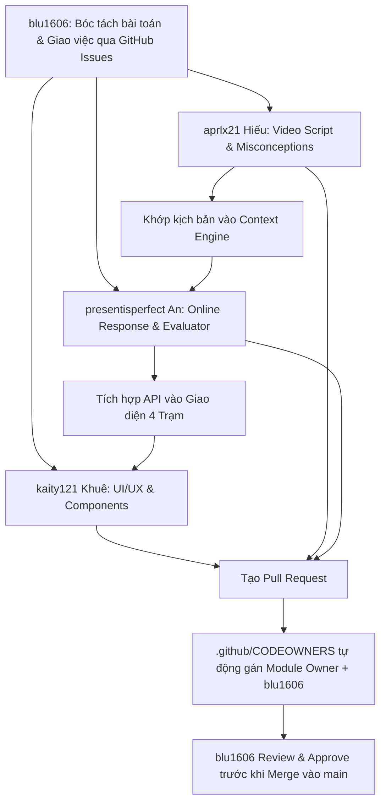

# 👥 Bảng Phân công Trách nhiệm & Quyền sở hữu Module (Team Ownership)

> **Dự án:** Nền tảng Học tập Đối chất Đa tác nhân (DRE Multi-Agent Interactive Learning)  
> **Cấu hình tự động:** Xem file cấu hình GitHub PR tại [`.github/CODEOWNERS`](../.github/CODEOWNERS).

---

## 🏛️ Đội ngũ Cốt lõi & Phân bổ Trách nhiệm

| Thành viên | GitHub Handle | Vai trò cốt lõi | Phạm vi phụ trách chính (Scope & Modules) |
| :--- | :--- | :--- | :--- |
| **Blu** | [`@blu1606`](https://github.com/blu1606) | **Project Lead / Tech Lead / Reviewer** | • **Giao việc & Điều phối:** Phân chia Issues, bóc tách task, quản lý Roadmap & Milestones. • **Final Reviewer:** Duyệt toàn bộ Pull Request (Code Quality, Architecture & Security). • **Kiến trúc hệ thống:** Cấu hình repository, CI/CD, chuẩn tích hợp giữa UI và Multi-Agent. |
| **Khuê** | [`@kaity121`](https://github.com/kaity121) | **Lead UI/UX & Frontend Interaction** | • Giao diện 4 trạm EdTech Room, CSS tokens, micro-interactions. • Bộ linh kiện SVG, vẽ hình học không gian, MathVector KaTeX. • Trải nghiệm F2 demo 1 chạm & Pitch Deck showcase. |
| **Hiếu** | [`@aprlx21`](https://github.com/aprlx21) | **Agent Lead - Video Scriptwriting & Dialogue Pipeline** | • Biên kịch lời thoại 4 bạn học AI (Bo, Linh Chi, Nam, Mai) từ video bài giảng. • Thư viện chẩn đoán ngộ nhận (`misconceptions.ts`). • Dữ liệu phân cảnh video & mốc dừng sư phạm (`videoLessons.ts`). |
| **An** | [`@presentisperfect`](https://github.com/presentisperfect) | **Agent Lead - Online Response & Session Context** | • Luồng sinh phản hồi trực tiếp (Real-time Online Response). • Quản lý ngữ cảnh phiên học (Session Memory & Context Buffer). • Bộ máy chẩn đoán câu trả lời (`evaluator.ts`) & Gateway API Backend. |

---

## 📂 Chi tiết Phân định Thư mục & File Source Code

### 0. Blu ([`@blu1606`](https://github.com/blu1606)) — Quản lý dự án, Giao việc & Final Reviewer
* **Trách nhiệm trọng tâm:**
  - Định nghĩa kiến trúc, chuẩn mực kỹ thuật và review toàn bộ PR của dự án.
  - Phân bổ issue, gắn nhãn (labels), gán assignee và theo dõi tiến độ hoàn thành (Milestones).
  - Điều phối các điểm chạm (Integration Points) giữa luồng UI của Khuê và 2 luồng Agent của `@aprlx21` & `@presentisperfect`.
* **Thư mục sở hữu trực tiếp:**
  - `.github/` (CODEOWNERS, GitHub Actions, Issue/PR templates).
  - `docs/TEAM_RESPONSIBILITIES_AND_OWNERSHIP.md`, `docs/README.md`.
  - Cấu hình gốc dự án: `package.json`, `tsconfig*.json`, `vite.config.ts`.

### 1. Khuê ([`@kaity121`](https://github.com/kaity121)) — Giao diện & Tương tác người dùng
* `src/components/`:
  - `VideoPlayerSheet.tsx` (Khung video 16:9, điều khiển dừng/tiếp tục).
  - `VideoDebateSheet.tsx` (Cột tương tác lớp học, chat stream & bubble).
  - `WorkingObjectSheet.tsx` & `InteractionCardSheet.tsx` (Trạm 2: Vở bài tập bắt lỗi Bo).
  - `AlternativeFlowsSheet.tsx` (Trạm 3: POE & Trạm 4: Gia sư Protégé).
  - `ScenarioPlayerBar.tsx` (Thanh điều khiển phím F2).
  - `MathVector.tsx`, `HandmadeArtwork.tsx` (Ký hiệu toán & hình vẽ không gian).
* `src/index.css`: Toàn bộ Token bảng màu, hiệu ứng glassmorphism, typography Be Vietnam Pro & JetBrains Mono.
* `src/App.tsx`, `src/main.tsx`, `public/`.
* `docs/PITCH_DECK*`, `docs/WIREFRAME*`, `docs/PHAN_TICH_HANH_VI*`.

### 2. Hiếu ([`@aprlx21`](https://github.com/aprlx21)) — Biên kịch Lời thoại & Ngữ cảnh Bài giảng
* `src/data/videoLessons.ts`:
  - Cấu trúc kịch bản video từng phân đoạn (00:00 -> 58:00).
  - Mốc dừng checkpoint sư phạm tại các giây quan trọng (ví dụ 37:13).
  - Lời thoại mồi của Bo, phản biện sắc sảo của Linh Chi, gợi ý của Nam và củng cố của Mai.
* `src/data/misconceptions.ts`:
  - Từ điển các ngộ nhận vectơ không gian (cộng quy tắc đuôi, bẫy dấu trừ, tách sai độ dài).
* `docs/KICH_BAN_TEST_CASE_DEMO_5_PHUT_THAY_TIEN.md`: Kịch bản mẫu kiểm thử chất lượng lời thoại.
* `docs/TC_API_USER_INPUT_CHAT_01.json`: Bộ mẫu test case payload gửi nhận giữa Agent và người học.

### 3. An ([`@presentisperfect`](https://github.com/presentisperfect)) — Xử trị Online Response & Session Context
* `src/services/dreBackendApi.ts`:
  - Cổng gọi API Backend đa tác nhân (OpenMAIC / OpenAI / Gemini).
  - Xử lý streaming response, fallback khi mạng chập chờn, mô phỏng phản hồi gõ phím.
* `src/utils/evaluator.ts`:
  - Thuật toán chẩn đoán ý đồ và độ chính xác câu trả lời của học sinh.
  - Phân tích điểm tháp Bloom và phân loại cấp độ hiểu biết.
* `src/types/dre.ts`:
  - Hệ thống định nghĩa kiểu dữ liệu (TypeScript Interfaces): `StationId`, `ChatMessage`, `AgentPersonality`, `DiagnosticMetrics`, `SessionState`.
* Quản trị bộ đệm ngữ cảnh (Context Window) & Session History giữa các lượt chat đối chất.

---

## 🔄 Quy trình Phối hợp, Giao việc & Review PR (Workflow)

1. **Khâu giao việc & mở Issue (Bởi `@blu1606`):**
   - Mọi tính năng, fix bug hoặc kịch bản mới đều được mở Issue trước và gán assignee rõ ràng (`@kaity121`, `@aprlx21`, hoặc `@presentisperfect`).
2. **Khi thay đổi Interface dữ liệu (`src/types/dre.ts`):** 
   - `@presentisperfect` và `@aprlx21` thống nhất payload, `@kaity121` review tương thích UI, `@blu1606` duyệt schema.
3. **Khi thêm lời thoại hoặc mốc bài giảng mới:**
   - `@aprlx21` cập nhật file trong `src/data/`, PR sẽ tự động gán `@aprlx21` và `@blu1606`.
4. **Khi tinh chỉnh logic tương tác hoặc animation trạm:**
   - `@kaity121` cập nhật component trong `src/components/`, đảm bảo không làm gãy contract gọi sang `dreBackendApi.ts`.
5. **Quy tắc duyệt & Merge:**
   - Mọi Pull Request cần ít nhất 1 phê duyệt từ người phụ trách module và **bắt buộc có phê duyệt từ `@blu1606`** trước khi merge vào nhánh `main`.
