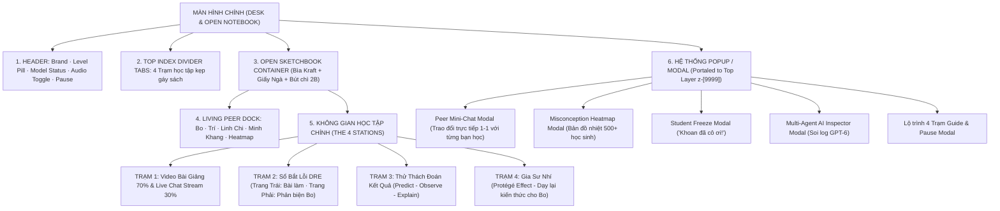

# TỔNG HỢP TOÀN BỘ WIREFRAME HỆ THỐNG DRE LEARNING PLATFORM
**Dự án:** Nền tảng Học tập Đối chất Đa tác nhân (DRE Multi-Agent Classroom)  
**Tác giả:** Khuê Minh (Frontend & Product UI/UX Lead)  
**Phong cách chủ đạo:** Moleskine Open Sketchbook (SuperrBook / Superr.ai) + OpenMAIC (Tsinghua University)  
**Quy chuẩn màn hình:** Độ phủ 92% Viewport (`max-w-[1520px]`), Zero Vertical Scroll trên laptop 16:9.

---

## 1. SƠ ĐỒ CẤU TRÚC PHÂN CẤP TỔNG THỂ (INFORMATION ARCHITECTURE)



---

## 2. WIREFRAME MÀN HÌNH CHÍNH & KHUNG SỔ TAY CỐ ĐỊNH (FRAMEWORK WIREFRAME)

```
+========================================================================================================================+
| [D] DRE Learning  | MISC_001 · Trung bình | [🟢 GPT-6 Live]                                 [🔊 Âm thanh] [☕ Tạm dừng] | <-- HEADER (48px)
+========================================================================================================================+
|                                                                                                                        |
|    +-------------------+  +-------------------+  +-------------------+  +-------------------+                          |
|    | == Washi Mint ==  |  | = Washi Amber =   |  | = Washi Honey =   |  | == Washi Sage ==  |                          |
|    | 🎬 TRẠM 1:        |  | ✍️ TRẠM 2:         |  | 🔮 TRẠM 3:        |  | 🎓 TRẠM 4:        |  [Chọn bài: 01|02|03..]   | <-- 4 TOP INDEX
|    | Video & Bo cãi    |  | Sổ bắt lỗi DRE    |  | Đoán kết quả (POE)|  | Dạy kèm cho Bo    |                          |     DIVIDER TABS
|----+-------------------+--+-------------------+--+-------------------+--+-------------------+--------------------------+
| +-[BÌA DA KRAFT SUPERR.AI]-------------------------------------------------------------------------------------------+ |
| | [Gáy]                                                                                                 [Quai cài bút| |
| |       +---------------------------------------------------------------------------------------------+ | chì gỗ 2B] | |
| |       | 🟢 BẠN HỌC MAIC: [👦 Bo]  [🧠 Trí]  [🌸 Linh Chi]  [💡 Minh Khang]  | 📊 BẢN ĐỒ NHIỆT [🔊 Âm]  | |            | | <-- PEER DOCK
| |       +---------------------------------------------------------------------------------------------+ |            | |
| |       |                                                             :                               | |            | |
| |       |                                                             :                               | |            | |
| |       |                 VÙNG HIỂN THỊ NỘI DUNG 4 TRẠM               :    VÙNG TƯƠNG TÁC / PHẢN BIỆN | |            | |
| |       |                 (Thay đổi linh hoạt theo Tab chọn)          :                               | |            | |
| |       |                                                             :                               | |            | |
| |       |                                                             :                               | |            | |
| |       +---------------------------------------------------------------------------------------------+ |            | |
| +--------------------------------------------------------------------------------------------------------------------+ |
+========================================================================================================================+
| 🌟 Sổ tay học Toán DRE · Cơ chế Tự giải thích & Bắt lỗi bạn học · Tsinghua OpenMAIC Architecture                      | <-- FOOTER (32px)
+========================================================================================================================+
```

---

## 3. WIREFRAME CHI TIẾT TRẠM 1: VIDEO 70% & LIVE CHAT STREAM 30%

```
+-----------------------------------------------------------------------+------------------------------------------------+
| TRANG TRÁI (70% VIEWPORT): VIDEO PLAYER & BẢNG PHẤN CÔ LAM            | TRANG PHẢI (30% VIEWPORT): LIVE CHAT LỚP HỌC   |
|                                                                       |                                                |
| [📺 Video Bài Giảng Tương Tác] [🔗 Gắn link video] [Tới câu hỏi 00:50] | 🔴 Lớp Học Trực Tuyến          [⏸ Câu hỏi dừng]|
| +-------------------------------------------------------------------+ | +--------------------------------------------+ |
| | [Khung Bảng Phấn Cổ Điển / YouTube Video 16:9 Player]             | | | 📌 Ghim từ Trợ giảng An [🤖 AI]:            | |
| |                                                                   | | | "Lưu ý cả lớp: Phải đặt ĐKXĐ trước khi     | |
| |  Cô Lam giảng bài:                                                | | |  biến đổi phương trình phân thức nhé!"     | |
| |  "Bài toán: Giải phương trình x(x - 2) = 3x                       | | +--------------------------------------------+ |
| |                                                                   | | | 🌸 Linh Chi: Tớ đang chép lại đề bài       | |
| |   x(x - 2) = 3x                                                   | | | 💡 Minh Khang: Cẩn thận nghiệm x = 0 nha!  | |
| |   Hai vế đều xuất hiện x, có bạn nào muốn chia cả 2 vế cho x?     | | | 👦 Bo Ngây Ngô: Ủa chia phăng đi cho nhanh | |
| |                                                                   | | |  tự nhiên chuyển vế chi cho mệt vậy?       | |
| |  🛑 ĐIỂM SUY NGẪM TRÊN BẢNG:                                      | | +--------------------------------------------+ |
| |  Theo em, phương trình này có tập nghiệm là gì và nên giải thế nào| | | Nhắn cho bạn: [@Bo] [@Trí] [@Chi] [@Khang] | |
| |                                                                   | | | [Nhập tin nhắn vào luồng lớp học...] [Gửi] | |
| +-------------------------------------------------------------------+ | +--------------------------------------------+ |
| | ▶️ [00:50 / 03:00] [1x]                      [✋ Khoan đã cô ơi!] | | 👩‍🏫 CÔ LAM DỪNG VIDEO ĐẶT CÂU HỎI: [Bỏ qua ⏩]|
| +-------------------------------------------------------------------+ | "Theo em, phương trình x(x-2)=3x giải sao?"   |
| 💡 Video bên trái và kịch bản tóm tắt bên phải luôn đồng bộ 100%.     | (o) Chuyển vế đặt nhân tử: x = 0 hoặc x = 5   |
|                                                                       | ( ) Chia 2 vế cho x: Nghiệm duy nhất x = 5   |
+-----------------------------------------------------------------------+------------------------------------------------+
```

---

## 4. WIREFRAME CHI TIẾT TRẠM 2: SỔ TAY BẮT LỖI DRE (DRE WORKSHEET)

```
+-------------------------------------------------------+-------------------------------------------------------+
| TRANG TRÁI (60%): BÀI GIẢI CỦA BO (Working Object)    | TRANG PHẢI (40%): THẺ SOI BẪY & PHẢN BIỆN (DRE Card)  |
|                                                       |                                                       |
| 📌 Phiếu Bài Tập: MISC_001 (Đại số 7 - Quy tắc dấu)   | 🎯 BƯỚC 1: XÁC ĐỊNH BƯỚC SAI                          |
| Đề bài: Rút gọn biểu thức B = 5x - (3x - 4)           | Bạn đã đánh dấu: [Dòng 2]                             |
|                                                       |                                                       |
| [1] Dòng 1: B = 5x - (3x - 4)                         | 💬 BƯỚC 2: BO TUNG LẬP LUẬN BƯỚNG (Intuitive Fallacy) |
|     (Phát biểu ban đầu của bài toán)                  | [👦 Bo Avatar]:                                       |
|                                                       | "Ủa Huy ơi, phá ngoặc thì cứ bỏ ngoặc đi thôi,        |
| [2] Dòng 2: B = 5x - 3x - 4    <-- [🔴 BẠN BẤM CHỌN]  |  số -4 đằng sau liên quan gì mà phải đổi thành +4?"   |
|     (Học sinh click trực tiếp vào dòng này để bắt lỗi)|                                                       |
|                                                       | ✍️ BƯỚC 3: GÕ PHẢN BIỆN ĐÁP TRẢ BO (Rebuttal)         |
| [3] Dòng 3: B = 2x - 4                                | +---------------------------------------------------+ |
|     (Kết luận sai của Bo)                             | | [Mẩu giấy ghi chú]:                               | |
| ----------------------------------------------------- | | "Trước ngoặc có dấu trừ thì bên trong phải đổi    | |
| 📊 Thống kê: 74% học sinh toàn quốc nhầm ở Dòng 2     | |  dấu tất cả các số hạng, -(-4) thành +4 chứ Bo!"  | |
| ⏱️ Hesitation Index: 1.6 (Tư duy dứt khoát)           | +---------------------------------------------------+ |
|                                                       | Gợi ý nhanh: [Đổi dấu ngoặc] [Thử số x=1]             |
|                                                       | [ GỬI PHẢN BIỆN CHO BO 🚀 ]      [💡 Xin Cô Lam gợi ý]|
+-------------------------------------------------------+-------------------------------------------------------+
```

---

## 5. WIREFRAME CHI TIẾT TRẠM 3 & TRẠM 4: POE VÀ DẠY KÈM BO (PROTÉGÉ)

### Trạm 3: Dự đoán kết quả (Predict - Observe - Explain - POE)
```
+---------------------------------------------------------------------------------------------------------------+
| 🔮 TRẠM 3: PREDICT - OBSERVE - EXPLAIN (Thử thách phán đoán trước khi nhìn bài giải)                           |
+---------------------------------------------------------------------------------------------------------------+
| BÀI TOÁN THỬ THÁCH: Biểu thức A = -(2x - 5) + 3                                                               |
|                                                                                                               |
| [1. PREDICT - DỰ ĐOÁN]                                                                                        |
| Bo cá cược: "Khi bỏ dấu ngoặc, số 5 sẽ mang dấu ÂM (-) hay DƯƠNG (+)?"                                        |
|   [ (A) Mang dấu ÂM (-) ]       [ (B) Mang dấu DƯƠNG (+) (Khuyên chọn) ]                                      |
|                                                                                                               |
| [2. OBSERVE - QUAN SÁT BẢNG PHẤN HÉ LỘ] (Chỉ mở ra sau khi học viên bấm dự đoán)                              |
| +-----------------------------------------------------------------------------------------------------------+ |
| | Bảng phấn bí mật hé mở: -(2x - 5) = -2x + 5. Do đó A = -2x + 5 + 3 = -2x + 8.                             | |
| +-----------------------------------------------------------------------------------------------------------+ |
|                                                                                                               |
| [3. EXPLAIN - GIẢI THÍCH NGUYÊN LÝ]                                                                           |
| Lời giải thích từ Cô Lam: "Chính xác! Dấu trừ đằng trước ngoặc làm đổi dấu của -5 thành +5!"                   |
+---------------------------------------------------------------------------------------------------------------+
```

### Trạm 4: Gia sư nhí giảng lại cho Bo (Protégé Effect)
```
+---------------------------------------------------------------------------------------------------------------+
| 🎓 TRẠM 4: GIA SƯ NHÍ (Đóng vai thầy giáo hướng dẫn lại quy tắc cho bạn Bo ngây ngô)                          |
+---------------------------------------------------------------------------------------------------------------+
| TÌNH HUỐNG: Bo đang ngồi gãi đầu trước bài toán: 1/3 + 1/4 = 2/7                                              |
|                                                                                                               |
| [👦 Bo cầu cứu]: "Cậu ơi, 1+1=2, 3+4=7, tớ thấy cộng tử với tử, mẫu với mẫu hợp lý lắm mà sao cô chấm 0 điểm?" |
|                                                                                                               |
| BẠN SẼ GIẢNG CHO BO THEO CÁCH NÀO? (Chọn hoặc tự gõ phương pháp):                                             |
| [1] Dùng ví dụ cắt bánh pizza của Minh Khang: Cắt 1/3 cái bánh và 1/4 cái bánh xem kích thước có gộp được ko?|
| [2] Dùng công thức chuẩn của Linh Chi: Tìm Mẫu thức chung là 12 rồi quy đồng tử số trước.                    |
| [3] Tự gõ lời giảng bằng ngôn từ của bạn...                                                                  |
|                                                                                                               |
| [👦 Bo giác ngộ]: "Aaaa! Tớ hiểu rồi, miếng bánh 1/3 to hơn miếng 1/4 nên không thể đếm khơi khơi được!"      |
| [🏆 ĐÃ HOÀN THÀNH VAI TRÒ GIA SƯ NHÍ · CHỨNG NHẬN MASTER KIẾN THỨC]                                           |
+---------------------------------------------------------------------------------------------------------------+
```

---

## 6. WIREFRAME CÁC MODAL TƯƠNG TÁC LỚP TRÊN (PORTALED MODALS)

### Modal 1: Nhắn tin trực tiếp 1-1 với Bạn học (Bo / Trí / Linh Chi / Minh Khang)
```
+-----------------------------------------------------------------------------------+
| [Washi Blue]                                                                  [✕] |
| 👦 Nhắn tin trao đổi cùng Bo (Class Clown)                                         |
| Vai trò OpenMAIC: Đấu trí phản biện, lật tẩy bẫy tư duy trực giác                 |
+-----------------------------------------------------------------------------------+
| [Khung chat hội thoại]:                                                           |
|                                                                                   |
|  [Bo]: "Tớ thấy biểu thức có số giống nhau thì cứ gạch phăng đi cho nhanh!         |
|         Cậu chỉ ra xem tớ sai ở đâu nào?"                                         |
|                                                                                   |
|  [Bạn]: "Phép cộng không được gạch tùy tiện như phép nhân đâu Bo!"                |
|                                                                                   |
|  [Bo]: "Ơ... cậu nói thế làm tớ hơi giật mình rồi đấy! Để tớ kiểm tra lại xem!"   |
+-----------------------------------------------------------------------------------+
| Gợi ý hỏi nhanh: ["Phép cộng không gạch được!"] ["Thử thay số x=2 xem!"]          |
| [Nhắn tin trao đổi cùng Bo...]                                            [Gửi 🚀]|
|                                                                      [Đóng lại]   |
+-----------------------------------------------------------------------------------+
```

### Modal 2: Bản đồ nhiệt ngộ nhận (Misconception Heatmap)
```
+-----------------------------------------------------------------------------------+
| 🔥 BẢN ĐỒ NHIỆT NGỘ NHẬN TOÁN HỌC (MAIC Behavioral Analytics)                 [✕] |
| Dữ liệu tổng hợp từ 500+ học sinh và các ca cãi ngẫu nhiên của Bo                 |
+-----------------------------------------------------------------------------------+
| Bước 1: Phân tích tử và mẫu thành nhân tử        [ 32% vướng ] 🟨 (Mức trung bình)|
|                                                                                   |
| Bước 2: Rút gọn số hạng tự do (Bẫy của Bo!)      [ 74% VƯỚNG ] 🟥 (ĐIỂM NÓNG CAO) |
|                                                                                   |
| Bước 3: Viết kết quả tối giản                    [ 14% vướng ] 🟩 (Ít học sinh sai|
|                                                                                   |
| 💡 Lời khuyên: 74% bạn học cũng từng nhầm ở Bước 2. Em không hề đơn độc đâu!      |
|                                                                      [Đóng lại]   |
+-----------------------------------------------------------------------------------+
```
