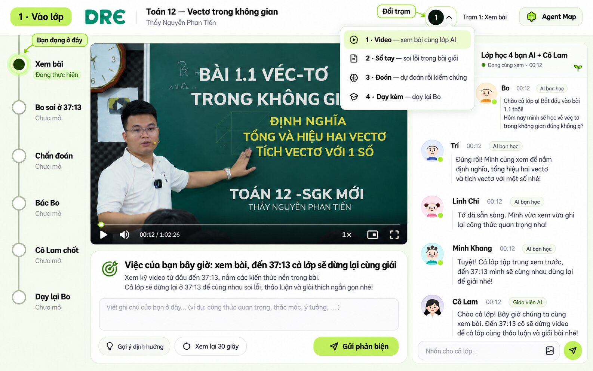
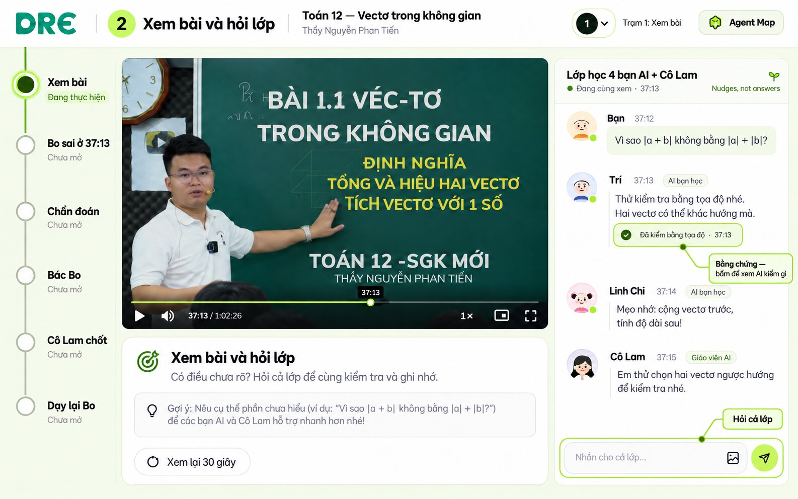
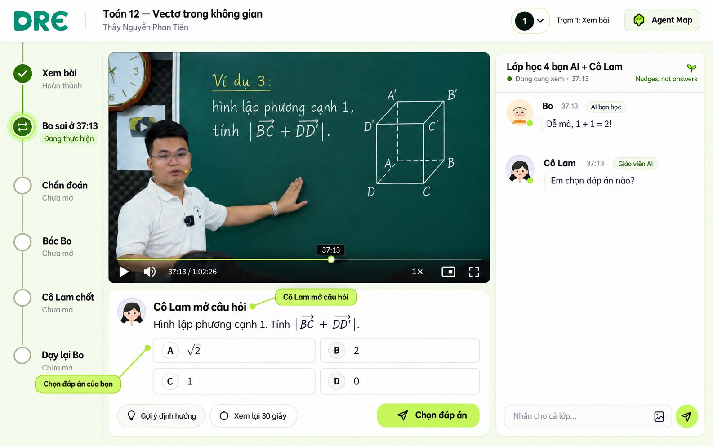
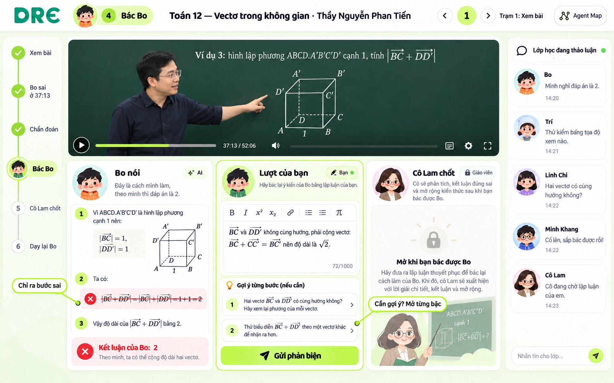
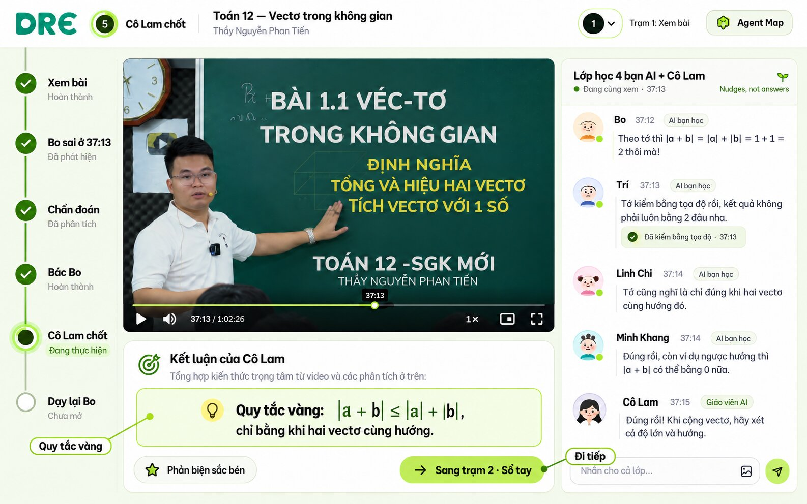
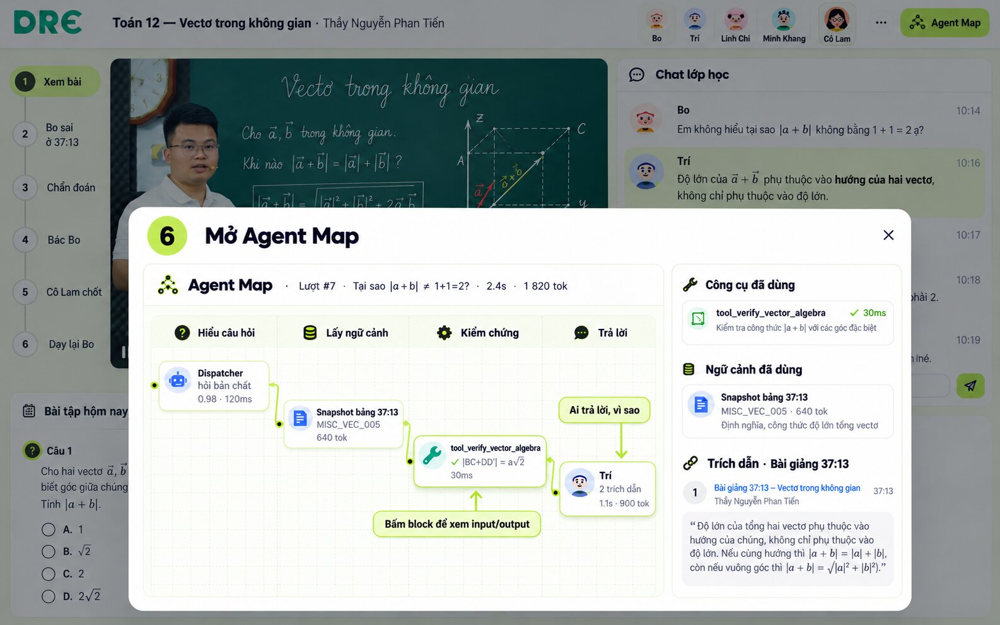
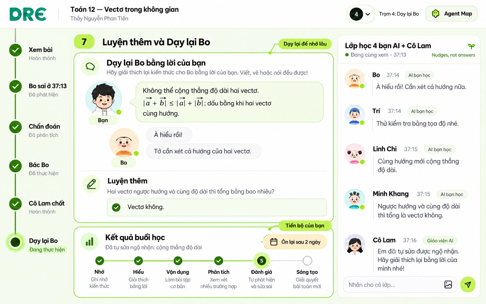

# Hướng dẫn sử dụng DRE: học cùng lớp AI, từng bước

> **"Nudges, not answers."** DRE không giải hộ bạn. Bạn học AI tên Bo sẽ sai trước, và bạn là người đi sửa lỗi cho Bo. Mọi điều AI nói đều có thể mở ra xem: ai trả lời, đã kiểm chứng bằng công cụ nào, dựa vào giây nào của bài giảng.

Bài demo là *Toán 12, Vectơ trong không gian*, thầy Nguyễn Phan Tiến.

Ảnh tổng hợp cả 7 bước: [images/huong-dan-tong-hop.jpg](images/huong-dan-tong-hop.jpg)

> Ảnh trong tài liệu là ảnh minh họa của bố cục "Tuyến hành trình dọc" đã được duyệt. Giao diện thật có thể lệch đôi chút về chữ và khoảng cách.

---

## Màn hình có gì

| Vùng | Dùng để làm gì |
|---|---|
| **Thanh trên cùng** | Tên bài học, **nút tròn số trạm** để chuyển trạm, nút **Agent Map**, và menu **⋯** (âm thanh, đổi bài, tạm dừng, công cụ giáo viên). |
| **Tuyến hành trình** (cột trái) | 6 ga của buổi học: Xem bài, Bo sai ở 37:13, Chẩn đoán, Bác Bo, Cô Lam chốt, Dạy lại Bo. Ga sáng màu lime là chỗ bạn đang đứng. Ga có dấu ✓ là đã xong. |
| **Video và thẻ "Việc của bạn bây giờ"** (giữa) | Video bài giảng. Ngay bên dưới là việc cần làm tiếp theo, viết bằng một câu. |
| **Lớp học** (cột phải) | Chat với Bo, Trí, Linh Chi, Minh Khang và Cô Lam. |

Bốn nhân vật trong lớp học:
- **Bo** hay dùng trực giác và cố tình sai.
- **Trí** kiểm chứng mọi thứ bằng công cụ toán.
- **Linh Chi** cho mẹo nhớ.
- **Minh Khang** động viên.

---

## Bước 1. Vào lớp

1. Mở DRE. Ga **Xem bài** đang sáng.
2. Muốn đổi trạm, bấm **nút tròn số trạm** trên thanh trên cùng. Danh sách 4 trạm hiện ra:
   - **1 · Video:** xem bài cùng lớp AI.
   - **2 · Sổ tay:** soi lỗi trong một bài giải.
   - **3 · Đoán:** dự đoán, quan sát rồi giải thích.
   - **4 · Dạy kèm:** dạy lại Bo.
3. Nếu chưa biết làm gì, hãy đọc thẻ **"Việc của bạn bây giờ"** dưới video.

## Bước 2. Xem bài và hỏi lớp

1. Bấm phát video. Có chỗ nào chưa hiểu thì gõ câu hỏi vào ô **"Nhắn cho cả lớp…"**.
2. Mỗi câu hỏi chỉ có **đúng một bạn** trả lời, và bạn nào trả lời tùy vào loại câu hỏi:
   - Hỏi bản chất thì **Trí** trả lời, kèm công cụ kiểm chứng.
   - Hỏi công thức hay mẹo nhớ thì **Linh Chi**.
   - Bí bài thì **Trợ giảng An** gợi ý từng bậc.
3. Câu trả lời có chip **"✓ đã kiểm · 37:13"** nghĩa là đã được công cụ toán kiểm. Bấm chip để xem chi tiết (xem Bước 6).
4. Câu hỏi nằm ngoài bài giảng sẽ được nhắc quay lại đúng đoạn trong video.

## Bước 3. Dừng ở 37:13: Bo sai

1. Tới **37:13**, video tự dừng và tuyến hành trình chuyển sang ga **Bo sai ở 37:13**.
2. **Cô Lam** mở câu hỏi của Ví dụ 3: hình lập phương cạnh 1, tính |BC + DD'|.
3. Chọn đáp án của bạn. Bo sẽ chen vào bằng một cách giải tắt nghe rất xuôi tai, nhưng sai.

> Chọn đúng vẫn chưa xong. Bo sẽ thử bạn bằng một cái bẫy, vì chọn đúng chưa chắc đã là hiểu.

## Bước 4. Bác Bo

Thẻ việc cần làm mở ra thành **bàn đối chất 3 ô**:

| Ô | Nội dung |
|---|---|
| **Bo nói** | Lời giải của Bo. Bước sai bị gạch đỏ. |
| **Lượt của bạn** | Viết vì sao Bo sai, ví dụ: *"BC và DD' không cùng hướng, phải cộng vectơ: BC + CC' = BC', nên độ dài là √2."* |
| **Cô Lam chốt** | Khóa lại cho tới khi bạn bác được Bo. |

1. Nếu bí, mở **Gợi ý 1**, rồi **Gợi ý 2**. Gợi ý chỉ nhắc hướng, không cho đáp án.
2. Bấm **Gửi phản biện**. Nút này chỉ bấm được khi ô đã có nội dung.
3. Phản biện được chấm ngầm theo hai mức: *sắc bén* hoặc *chưa rõ*.
   - **Chưa rõ:** bạn được gợi ý thêm và viết lại.
   - **Sắc bén:** Bo chịu thua.

## Bước 5. Cô Lam chốt quy tắc vàng

1. Bo nhận sai, và **Cô Lam** chốt **quy tắc vàng**: |a + b| ≤ |a| + |b|, dấu bằng chỉ xảy ra khi hai vectơ cùng hướng.
2. Ga **Cô Lam chốt** được đánh dấu ✓.
3. Bấm nút đi tiếp để sang **Trạm 2 · Sổ tay**.

## Bước 6. Mở Agent Map: xem AI đã làm gì

Bạn mở được Agent Map bất cứ lúc nào, bằng **nút Agent Map** trên thanh trên cùng hoặc bằng **chip bằng chứng** trong chat.

Agent Map chia một lượt trả lời thành 4 cột:

| Cột | Cho bạn biết |
|---|---|
| **Hiểu câu hỏi** | Bộ điều phối hiểu câu hỏi của bạn thuộc loại nào, và vì sao chọn bạn AI đó trả lời. |
| **Lấy ngữ cảnh** | Đoạn bảng phấn và lời giảng quanh 37:13, cùng ngộ nhận trong kho tri thức được dùng. Mỗi bạn AI chỉ thấy phần dữ liệu thuộc vai của mình. |
| **Kiểm chứng** | Công cụ toán đã chạy và kết quả của nó, ví dụ |BC + DD'| = a√2. |
| **Trả lời** | Ai đã trả lời, kèm các trích dẫn. |

Bấm vào một block để xem đầu vào và đầu ra của bước đó. Thời gian và số token chỉ hiện khi hệ thống đo được.

## Bước 7. Luyện thêm và Dạy lại Bo

1. Ở **Trạm 2 · Sổ tay** và **Trạm 3 · Đoán**, bạn luyện tiếp: soi lỗi trong một bài giải, rồi dự đoán, kiểm chứng và giải thích.
2. Ở **Trạm 4 · Dạy kèm**, bạn giảng lại quy tắc cho Bo bằng lời của mình. Tự dạy lại là cách nhớ lâu nhất.
3. Thẻ **Kết quả buổi học** cho biết:
   - ngộ nhận bạn đã tự sửa;
   - bậc tư duy Bloom bạn đạt được;
   - lịch ôn lại.

---

## Phím tắt

| Phím | Tác dụng |
|---|---|
| `Space` | Tạm dừng hoặc chạy tiếp video |
| `Esc` | Đóng cửa sổ đang mở |
| `F2` | Chạy demo tự động 4 trạm (dùng khi trình diễn) |
| `Alt + I` | Mở bảng soi chi tiết (dành cho giáo viên) |

## Mẹo

- Không chắc phải làm gì thì nhìn **tuyến hành trình** và đọc thẻ **"Việc của bạn bây giờ"**.
- Muốn biết AI có "bịa" hay không, bấm **chip bằng chứng** hoặc mở **Agent Map**.
- Sai không sao cả. Ở DRE, Bo luôn sai trước bạn.
